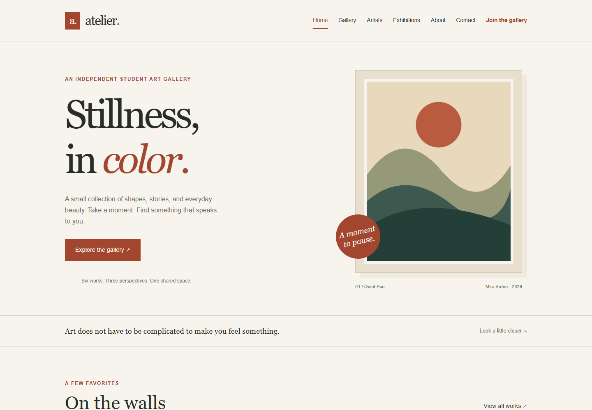
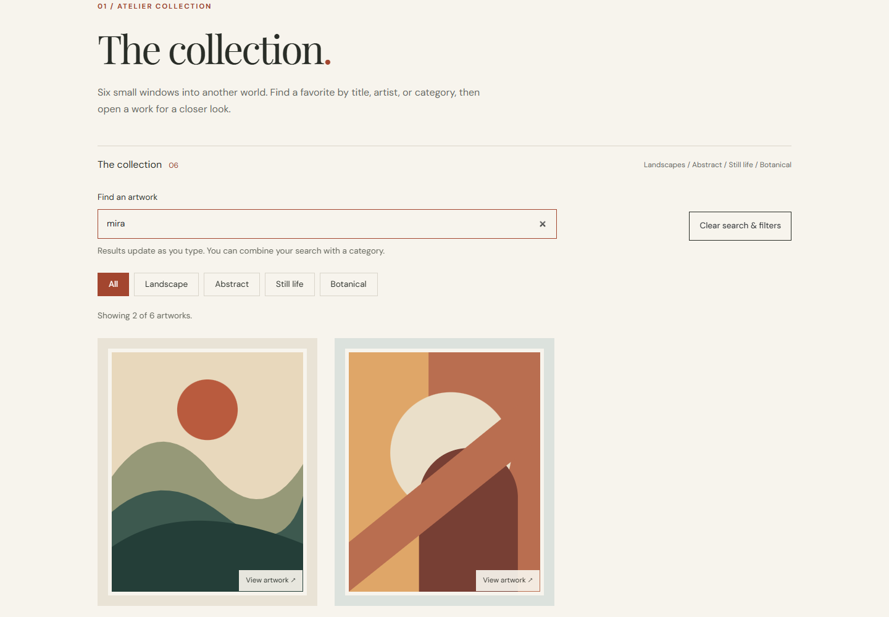
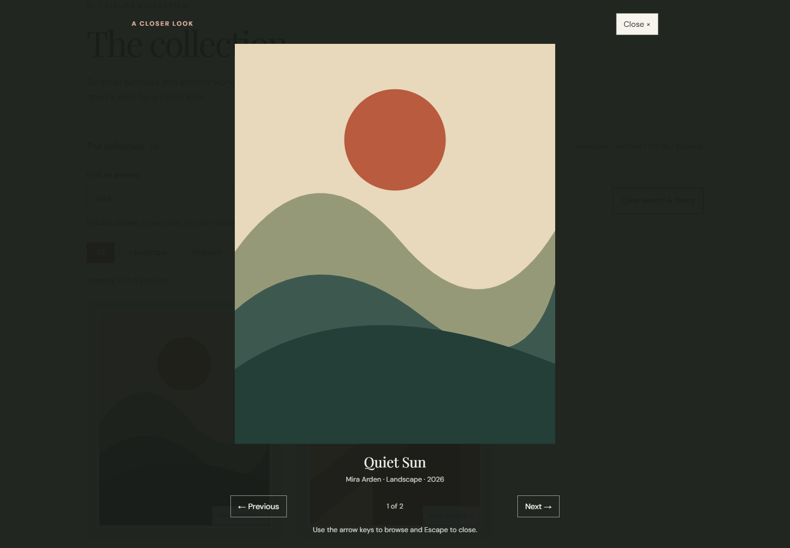
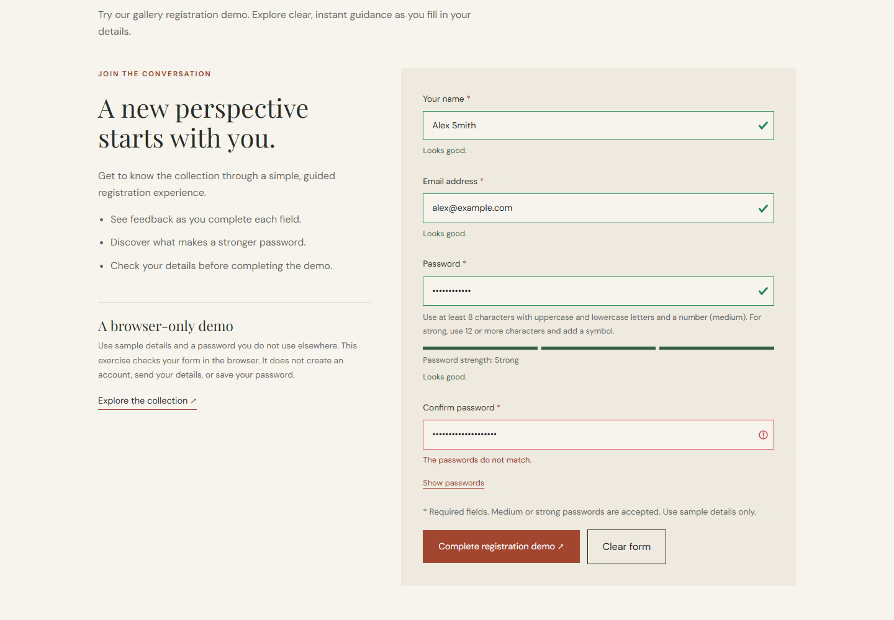
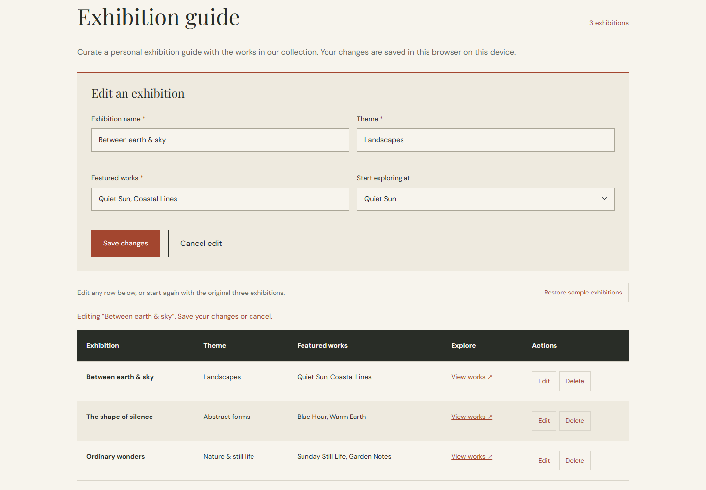
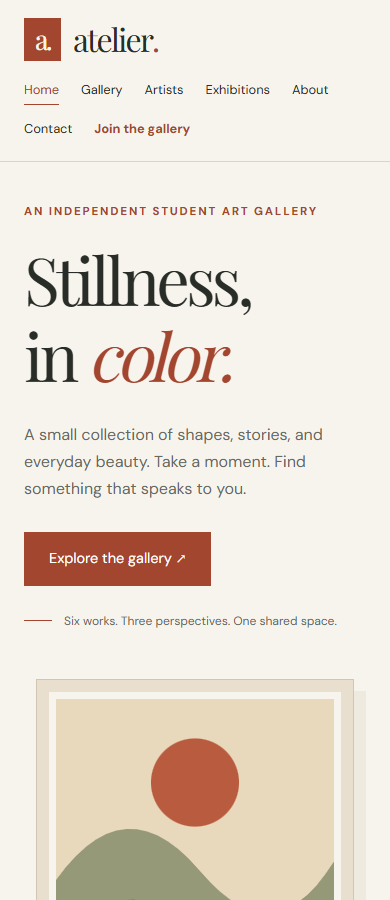

Atelier Art Gallery - Endterm

Topic: Art Gallery Website

Group members: Zhanserik Zharylgassyn and Erkebulan Korganbek

Website: https://znsrk.github.io/atelier-art-gallery-endterm/

Repository: https://github.com/znsrk/atelier-art-gallery-endterm

Original midterm: https://github.com/znsrk/atelier-art-gallery

Atelier is a responsive student art gallery. The endterm extends the original midterm website with JavaScript and jQuery while keeping its design, six original SVG artworks, fictional artists, and exhibition themes. The pages are Home, Gallery, Artists, Exhibitions, About, Contact, registration, and contact confirmation.

Features

Registration checks required names, email addresses, passwords, and password confirmation. Email validation uses a regular expression. Feedback appears as you type, and invalid submissions are blocked. The password indicator shows weak, medium, or strong. Medium requires at least 8 characters with uppercase and lowercase letters and a number. Strong requires at least 12 characters and a symbol as well. Successful registration clears the form. This is a demonstration; no account is created and no credentials are saved.

The gallery searches artwork titles, artists, and categories as you type. Search is case-insensitive and works together with the category buttons. A result count, empty state, and clear button help visitors browse. Clicking an artwork opens a lightbox with previous and next arrows and jQuery fade effects. Arrow keys browse the visible results, Escape closes the viewer, and keyboard focus returns to the selected artwork. Reduced-motion preferences are respected.

The exhibition guide supports adding, reading, editing, and deleting records. Invalid or whitespace-only entries are blocked. Deleting records and restoring the sample exhibitions require confirmation. Changes persist in the same browser using localStorage. If storage is unavailable, the table still works during the current page session. Records are not shared across browsers or devices.

The Contact form validates the required name, email, and message with immediate feedback. A valid submission opens the confirmation page without adding personal details to the URL. No message is sent or saved.

The original responsive layouts, navigation, footer, Bootstrap components, and artwork remain. The gallery can still display images without JavaScript.

Technologies

HTML5, CSS3, JavaScript, jQuery 3.7.1, Bootstrap 5.3.8 CSS, and original SVG illustrations. Bootstrap and the full jQuery build are included in the vendor folder with their license notices. DM Sans and Playfair Display load from Google Fonts, with system font fallbacks. The site has no backend or build step.

Run locally

Download the repository using Code > Download ZIP and extract it, or clone it:

git clone https://github.com/znsrk/atelier-art-gallery-endterm.git

cd atelier-art-gallery-endterm

Open index.html in a modern browser. No installation is needed to view the website. For consistent local storage behavior, open a terminal in the project folder and start a local server:

python -m http.server 8000

Open http://localhost:8000 and stop the server with Ctrl+C. On Windows, py -m http.server 8000 is an alternative.

Code locations

Page content is in the HTML files. Shared styles and exhibition styles are in css/style.css. Gallery styles are in css/gallery.css, and form styles are in css/forms.css.

js/script.js handles the exhibition table and local storage. js/gallery.js handles search, filters, and the lightbox. js/forms.js handles registration and contact validation. Comments explain the event handlers and functions. Images are in images/, and third-party files are in vendor/.

Navigation and footer markup repeat on each page. Update every copy when changing a shared link. New gallery artworks need data-title, data-artist, and data-category attributes for filtering.

Testing

Automated browser checks passed locally, on the published website, and in GitHub Actions. They cover all eight pages at 1440, 834, 390, and 320 pixels, artwork loading, links, labels, search, filters, lightbox controls, form validation, CRUD, persistence, and storage recovery.

The optional test dependencies are separate from the website. Install them and run the checks:

python -m pip install -r requirements-dev.txt

python tests/check.py

The test script uses installed Google Chrome on Windows. Otherwise install a test browser with python -m playwright install chromium, or set CHROME_PATH to a Chrome executable. Tests use an isolated browser and start and stop their own server. They do not change your saved exhibitions.

Run python tests/check.py --static-only for file checks. GitHub Actions runs the complete checks on pushes to main and on pull requests.

Publishing

GitHub Pages publishes the main branch from the repository root. Keep index.html at the root and push changes to update the website. Submit the website and repository links above.

Screenshots

Home page on desktop.

Gallery with live search and category filters.

Artwork lightbox with navigation controls.

Registration form with live validation and password strength feedback.

Exhibition editor and dynamic table.

Mobile layout.

